# layerscope — разбор Qwen3.5/3.8 на MLX: от промпта к ответу и какие слои за него отвечают

<p align="center">
  
  
  
  
  
  
</p>

<p align="center">
  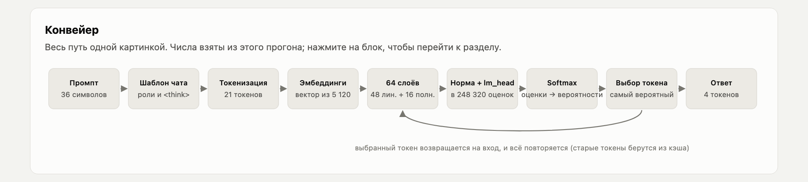
</p>

Модель ответила «Париж». **Почему именно так?** На каком из 64 слоёв ответ «созрел»? Какие слова промпта на него повлияли? Что бы изменилось, если убрать слой, и можно ли убрать его насовсем? **layerscope** запускает модель локально, записывает каждый шаг вычислений и собирает самодостаточный интерактивный отчёт — одну HTML-страницу, которая открывается двойным щелчком и работает без сети.

- **Видно весь путь**: шаблон чата, токены, эмбеддинги, каждый из 64 слоёв, логиты, выбор токена и его энтропия.
- **Измеряется, а не угадывается**: вклад слоёв в логит раскладывается точно; вклад слов промпта и важность слоёв получаются прямым вмешательством (подмена токена, отключение слоя).
- **Проверено на настоящей модели**, а то, что проверку не прошло, убрано (см. [docs/validation.md](docs/validation.md)).
- **Много промптов — один отчёт** с переключателем и сводкой.

## Разобранная модель

Все примеры в этом README получены на модели **[lmstudio-community/Qwen3.8-27B-MLX-4bit](https://huggingface.co/lmstudio-community/Qwen3.8-27B-MLX-4bit)** — 4-битной MLX-квантизации [Qwen/Qwen3.8-27B](https://huggingface.co/Qwen/Qwen3.8-27B), которую сделала команда LM Studio.

| | |
|---|---|
| База | Qwen/Qwen3.8-27B, 27 млрд параметров |
| Формат | MLX, 4 бита, 16,1 ГБ на диске (по карточке модели), 15,13 ГБ в памяти |
| Лицензия | Apache-2.0 (по карточке модели) |
| Архитектура | 64 слоя: **48 с линейным вниманием** (Gated DeltaNet) и **16 с полным** — по одному на каждые четыре |
| Размеры | вектор токена 5 120, словарь 248 320 токенов |
| Загрузка | `mlx-vlm`, `model_type: "qwen3_5"` |

Инструмент рассчитан именно на это семейство (Qwen3.5/3.8 в формате `mlx-vlm`); другие архитектуры не поддерживаются.

## Экскурсия по отчёту

Каждый шаг ниже — настоящий снимок раздела отчёта на промпте **«Назови столицу Франции одним словом.»** (ответ «Париж»). Разделы раскрываются по клику.

<details open>
<summary><b>0. Обзор прогона</b> — что запускали и сколько это весит</summary>

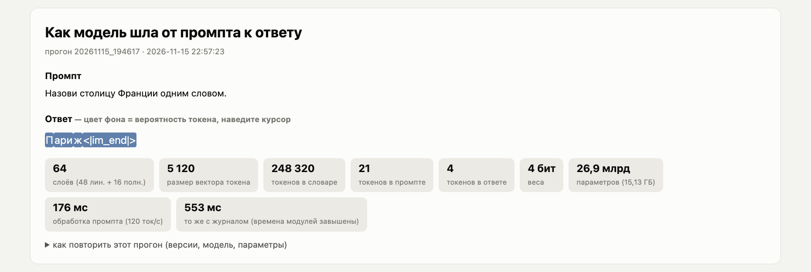

**Что показывает.** Промпт и ответ, в котором цвет фона токена — его вероятность. Ответ «Париж» — это три токена `П` · `ари` · `ж`, четвёртый шаг выбирает токен конца `<|im_end|>`. Плитки: 64 слоя (48 линейных + 16 полных), вектор 5 120, словарь 248 320, 21 токен в промпте, 26,9 млрд параметров при 4 битах.

**Как читать времена.** Обработка промпта — 176 мс (120 токенов/с): это реальная скорость, она мерится отдельным прогоном без журнала. 553 мс — тот же шаг с журналом: чтобы снять статистику, вычисления приходится завершать после каждого модуля, и времена модулей завышены. Раскрывающаяся строка внизу хранит всё, чтобы прогон можно было повторить: версии библиотек, отпечаток модели, параметры.

</details>

<details>
<summary><b>1. Шаблон чата и токены</b> — что модель получает на самом деле</summary>

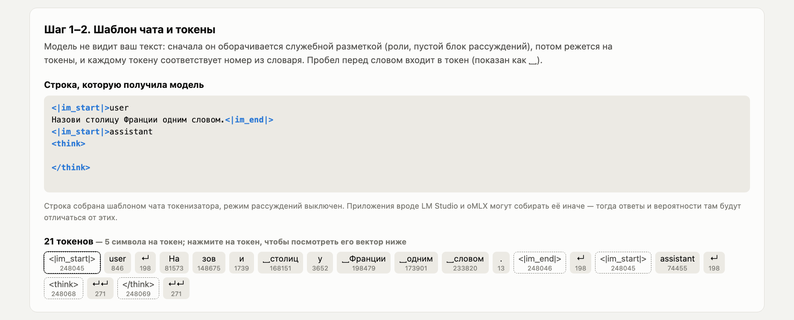

**Что показывает.** Модель не видит ваш текст: сначала его оборачивают служебной разметкой (роли `user`/`assistant`, пустой блок рассуждений `<think></think>`), потом режут на токены, и каждому соответствует номер из словаря.

**Пример.** 36 символов превратились в 21 токен. Пробел перед словом входит в токен (`␣столиц` — номер 168151, `␣Франции` — 198479). Служебные токены выделены пунктиром.

**Осторожно.** Строка собрана шаблоном токенизатора. LM Studio и oMLX могут собирать её иначе — тогда ответы и вероятности там будут отличаться, поэтому отчёт всегда показывает, что именно ушло в модель.

</details>

<details>
<summary><b>2. Эмбеддинги</b> — токен становится вектором</summary>

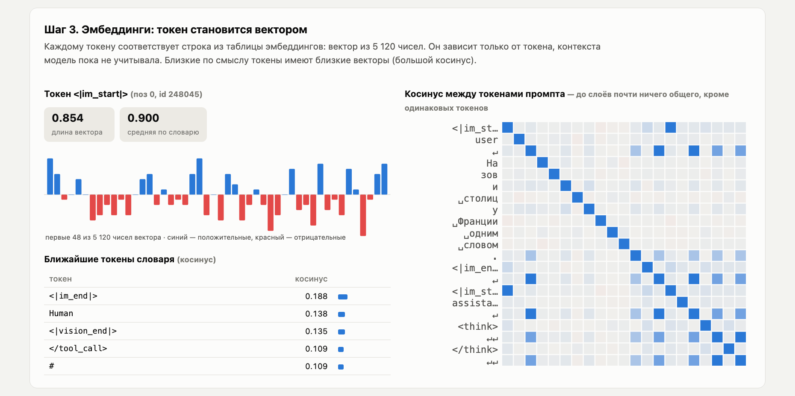

**Что показывает.** Каждому токену соответствует строка таблицы 248 320 × 5 120. Слева — первые 48 чисел вектора выбранного токена (синий — положительные, красный — отрицательные) и ближайшие токены словаря по косинусу. Справа — косинусы между токенами самого промпта.

**Как читать.** Контекст на этом этапе модель ещё не учитывала: вектор зависит только от токена. Поэтому одинаковые токены (`<|im_start|>` в позициях 0 и 14, переводы строк) дают яркие пятна вне диагонали. Для `<|im_start|>` длина вектора 0,854 при средней по словарю 0,900.

</details>

<details>
<summary><b>3. Слои</b> — 64 преобразования вектора, по одному клику на слой</summary>

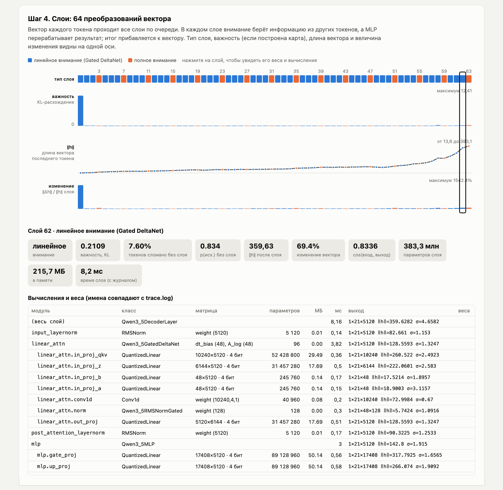

**Что показывает.** Ленту из 64 слоёв: синий — линейное внимание (Gated DeltaNet), оранжевый — полное, каждый четвёртый. Ниже на одной оси — важность слоя (KL при отключении), длина вектора последнего токена и величина изменения вектора слоем. Клик по слою раскрывает его вычисления.

**Пример: слой 62** (линейный). 383,3 млн параметров, 215,7 МБ; вектор на входе длиной 359,6 слой меняет на 69,4%. Если его отключить, 7,6% токенов ответа меняется (KL 0,2109). Таблица ниже показывает каждый модуль слоя: проекции `in_proj_qkv` (10 240 × 5 120, 4 бита), свёртку `conv1d`, нормировку, MLP.

</details>

<details>
<summary><b>4. Вектор токена по слоям</b> — как копится информация</summary>

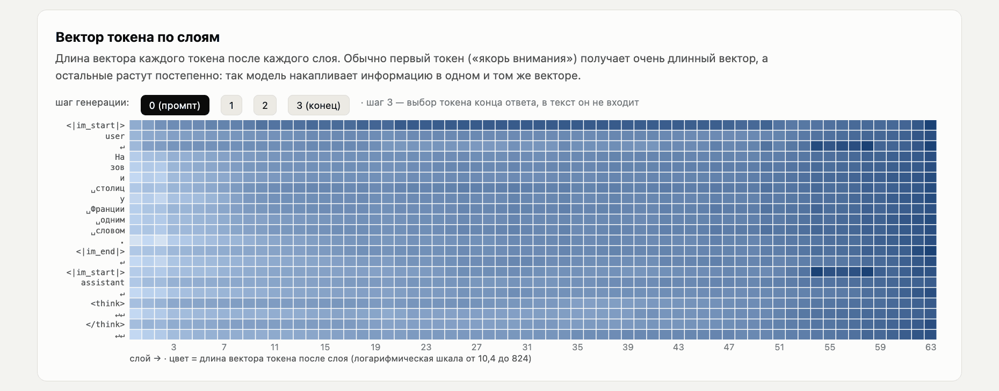

**Что показывает.** Длину вектора каждого токена после каждого слоя (логарифмическая шкала от 10,4 до 824). Кнопки сверху переключают шаг генерации.

**Пример.** К последним слоям векторы всех токенов растут. На слоях 54–58 у двух служебных токенов — перевода строки в позиции 2 и второго `<|im_start|>` — длина вектора резко вырастает (тёмные клетки): служебные токены накапливают очень большие значения.

</details>

<details>
<summary><b>5. Logit lens</b> — на каком слое «созревает» ответ</summary>

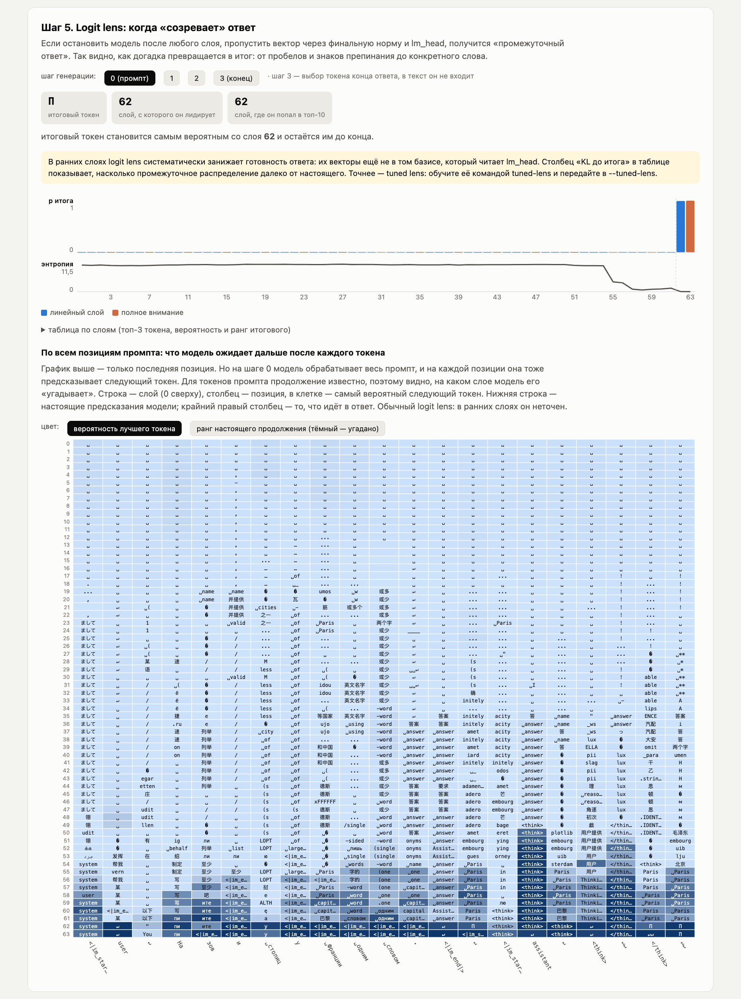

**Что показывает.** Если остановить модель после любого слоя и прочитать вектор финальной нормой и `lm_head`, получится «промежуточный ответ». Верхний график — вероятность итогового токена по слоям. Сетка ниже — то же для **каждой позиции** промпта: строка — слой, столбец — токен, в клетке самый вероятный следующий токен.

**Пример.** Итоговый токен `П` становится самым вероятным только со слоя **62** из 64 (p = 0,994, на 63-м слое 0,998). До этого последняя позиция ожидает английское `Paris` (слои 55–61, на 61-м p = 0,37), и лишь на слое 62 модель переключается на русское «П». Нижняя строка сетки — настоящие предсказания модели.

**Осторожно.** В ранних слоях logit lens систематически неточен: их векторы ещё не в том базисе, который читает `lm_head`. Столбец «KL до итога» в таблице показывает размер ошибки; точнее — [tuned lens](#tuned-lens--исправленный-logit-lens).

</details>

<details>
<summary><b>6. Разложение логита</b> — какие слои привели к ответу</summary>

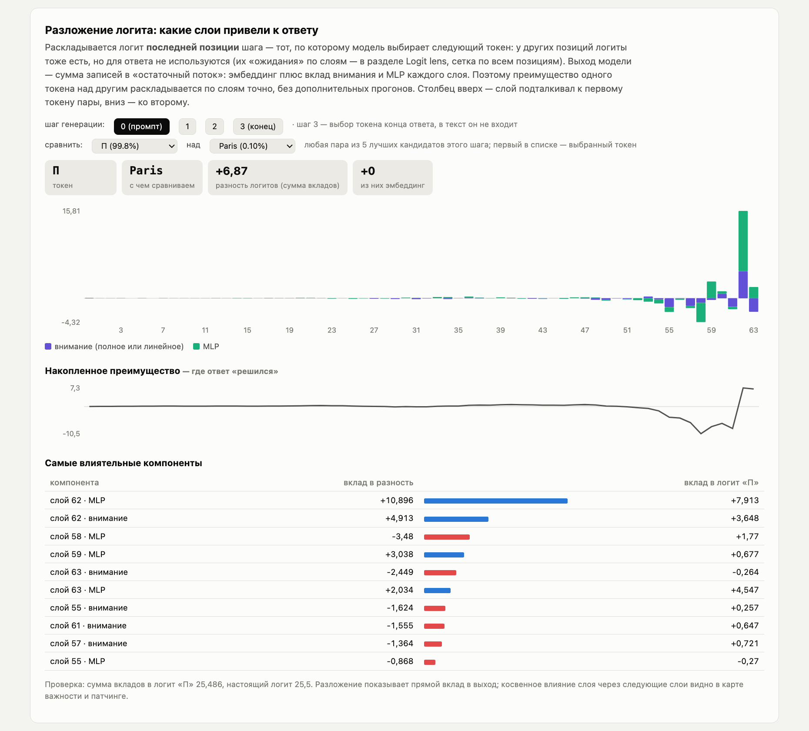

**Что показывает.** Выход модели — сумма записей в остаточный поток: эмбеддинг плюс вклад внимания и MLP каждого слоя. Поэтому преимущество одного токена над другим раскладывается по слоям **точно**. Раскладывается логит последней позиции — тот, по которому выбирается токен. Любую пару из пяти лучших кандидатов можно выбрать в списках («почему А, а не Б»).

**Пример.** `П` опережает `Paris` на 6,87. Сильнее всего «за» работают MLP слоя 62 (+10,9) и внимание слоя 62 (+4,9); сильнее всего «против» — MLP слоя 58 (−3,5) и внимание слоя 63 (−2,4). Линия «накопленное преимущество» показывает, где ответ решился: до слоя 58 перевес у `Paris` (−10,5), а на слое 62 выбор переворачивается (+7,3). Проверка: сумма вкладов 25,486 против настоящего логита 25,5.

</details>

<details>
<summary><b>7. Вклад токенов контекста</b> — какие слова промпта повлияли</summary>

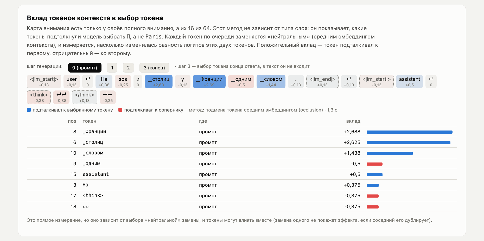

**Что показывает.** Каждый токен по очереди заменяется «нейтральным» (средним эмбеддингом контекста), и измеряется, насколько изменилась разность логитов выбранного токена и соперника. Положительный вклад — токен подталкивал к выбранному токену. Метод не зависит от типа слоя, около 1,3 с на шаг.

**Пример.** За `П` (а не `Paris`) отвечают слова вопроса: `␣Франции` +2,69, `␣столиц` +2,63, `␣словом` +1,44; `␣одним` тянет в обратную сторону (−0,5). На следующих шагах контекст включает уже выбранные токены ответа (они обведены фиолетовым), и отчёт показывает, какая доля вклада приходится на собственные токены модели.

**Осторожно.** Это прямое измерение, но оно зависит от выбора замены; токены могут влиять вместе, и замена одного не покажет эффекта, если соседний его дублирует. Градиентные методы (gradient × input, integrated gradients) не используются: на этой модели они не сошлись с прямой подменой ([подробнее](docs/validation.md)).

</details>

<details>
<summary><b>8. Внимание</b> — на какие токены смотрит выбранный токен</summary>

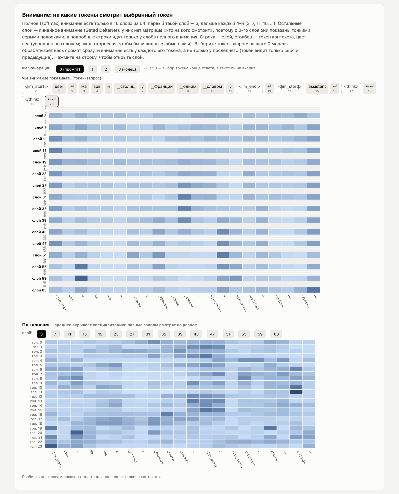

**Что показывает.** Полное (softmax) внимание есть только в 16 слоях из 64: 3, 7, 11 … 63. У остальных 48 слоёв (Gated DeltaNet) матрицы «кто на кого смотрит» нет, поэтому они показаны тонкими серыми полосками — ось слоёв идёт с нуля. На шаге 0 модель читает весь промпт сразу, так что можно выбрать токен-запрос (чипы сверху); внизу — разбивка по 24 головам для последнего токена.

**Пример.** Для последнего токена промпта в слоях 31–39 внимание сосредоточено на `␣словом`, в слоях 43–51 — на `<|im_end|>`, на слое 59 — на переводе строки в позиции 2, а на слое 63 — на нём самом. Веса восстановлены из запросов и ключей и сверены с настоящим выходом внимания (ошибка около 1% из-за bf16).

</details>

<details>
<summary><b>9. Выбор токена и энтропия</b> — как считается неуверенность</summary>

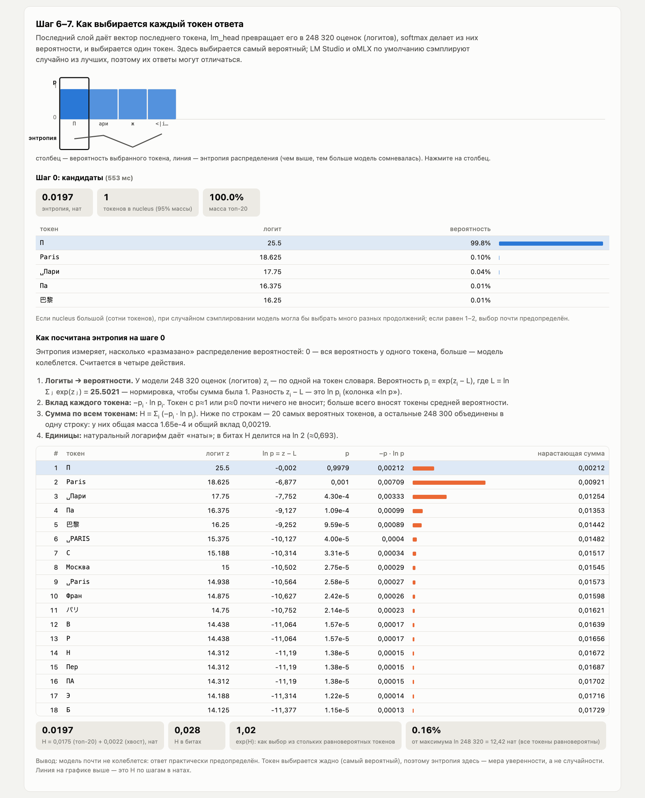

**Что показывает.** Как логиты превращаются в выбор, и как посчитана энтропия — по действиям: (1) вероятности из логитов `p = exp(z − L)`, где `L = ln Σ exp(z)` — нормировка; (2) вклад каждого токена `−p·ln p`; (3) сумма по топ-20 токенам и по «хвосту» из остальных 248 300; (4) нат и биты, перплексия `exp(H)` и доля от максимума `ln V`.

**Пример (шаг 0).** `П` — 99,8%, `Paris` — 0,10%. Энтропия 0,0197 нат (0,028 бит) = 0,0175 от топ-20 + 0,0022 от хвоста; `exp(H)` = 1,02 — как выбор из одного токена; это 0,16% от максимума 12,42 нат. Модель практически не колеблется.

</details>

<details>
<summary><b>10. Карта важности слоёв</b> — что сломается без слоя</summary>

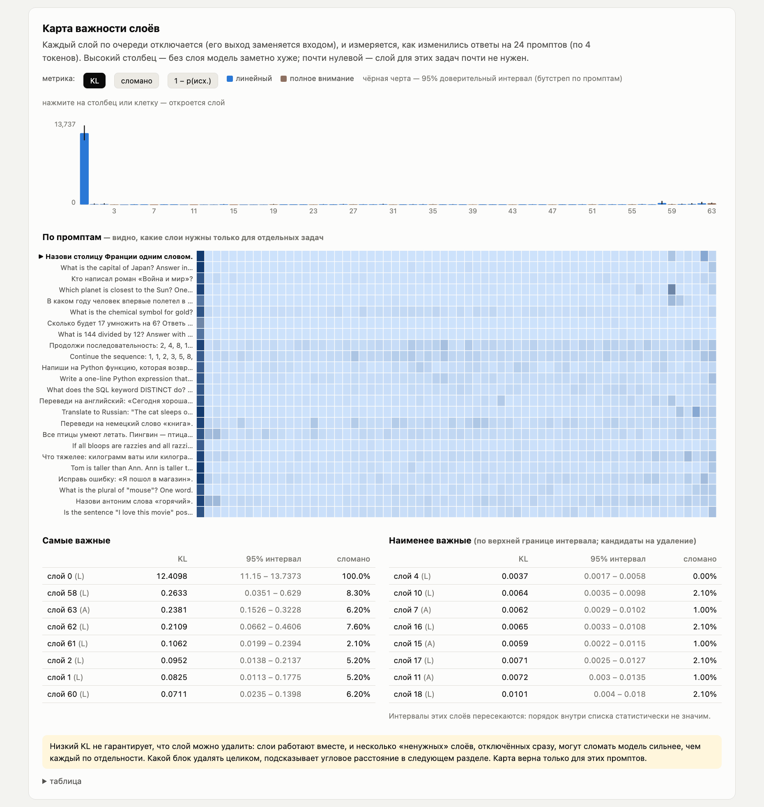

**Что показывает.** Каждый слой по очереди отключается (его выход заменяется входом), и измеряется, как изменились ответы на 24 промпта: KL между распределениями, доля токенов, где лучший кандидат стал другим, и 95%-й доверительный интервал (бутстреп по промптам). Тепловая карта показывает, какие слои нужны только для отдельных задач.

**Пример.** Без слоя 0 модель ломается полностью (KL 12,41, 100% токенов). Дальше с большим отрывом: слои 58 (0,26), 63 (0,24), 62 (0,21). Наименее важные — 4, 10, 7, 16, 15, 17, 11, 18 (KL ниже 0,011), но их интервалы пересекаются, и порядок внутри списка статистически не значим. Вопрос про планету заметно зависит от слоя около 58.

**Осторожно.** Низкий KL не гарантирует, что слой можно удалить: слои компенсируют друг друга. Карта верна только для этих промптов.

</details>

<details>
<summary><b>11. Угловое расстояние</b> — какой блок слоёв можно убрать целиком</summary>

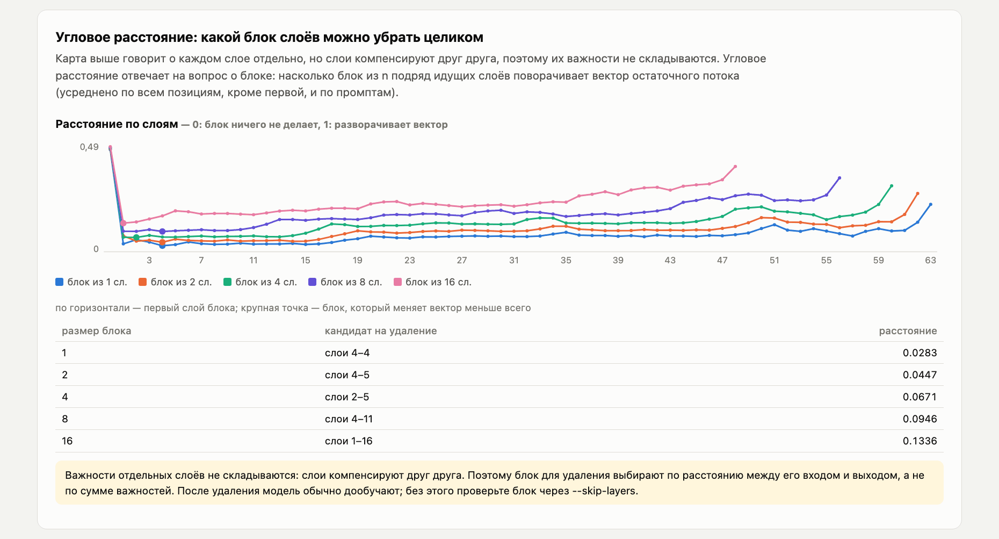

**Что показывает.** Важности отдельных слоёв не складываются, поэтому блок выбирают по тому, насколько он поворачивает вектор: чем меньше угол между входом и выходом блока из n слоёв, тем меньше блок меняет вектор (метод [Gromov et al.](https://arxiv.org/pdf/2403.17887)). Усреднено по всем позициям, кроме первой, и по промптам.

**Пример.** Лучшие кандидаты: один слой — слой 4 (0,028), два — слои 4–5 (0,045), четыре — слои 2–5 (0,067), восемь — слои 4–11 (0,095). Резкий пик в самом начале (слои 0–1) говорит, что их убирать нельзя.

**Осторожно.** Это кандидат, а не готовое решение: после удаления блока модель обычно дообучают, а без этого нужно проверить результат (`--skip-layers`).

</details>

<details>
<summary><b>12. Activation patching</b> — где проходит информация</summary>

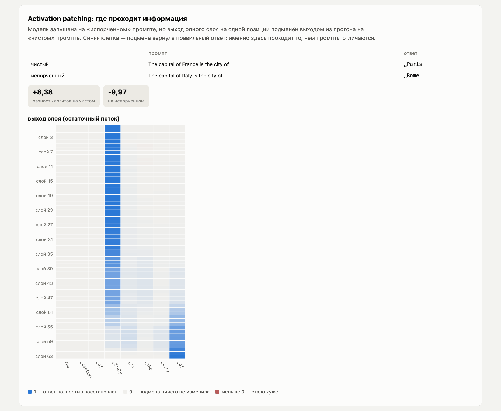

**Что показывает.** Два промпта, отличающиеся одной деталью: «чистый» (Франция → `Paris`) и «испорченный» (Италия → `Rome`). Модель запускается на испорченном, но выход одного слоя на одной позиции подменяется выходом из чистого прогона. Синяя клетка — подмена вернула правильный ответ: именно здесь проходит то, чем промпты отличаются.

**Пример.** До слоя ≈34 вся информация о стране лежит на самом токене `␣Italy` (подмена там почти полностью возвращает `Paris`). С середины слоёв она ослабевает, а начиная примерно со слоя 52 переходит в последнюю позицию `␣of` и на слое 63 достигает 1 — ответ полностью восстановлен.

</details>

<details>
<summary><b>13. Квантизация</b> — где сжатие искажает модель</summary>

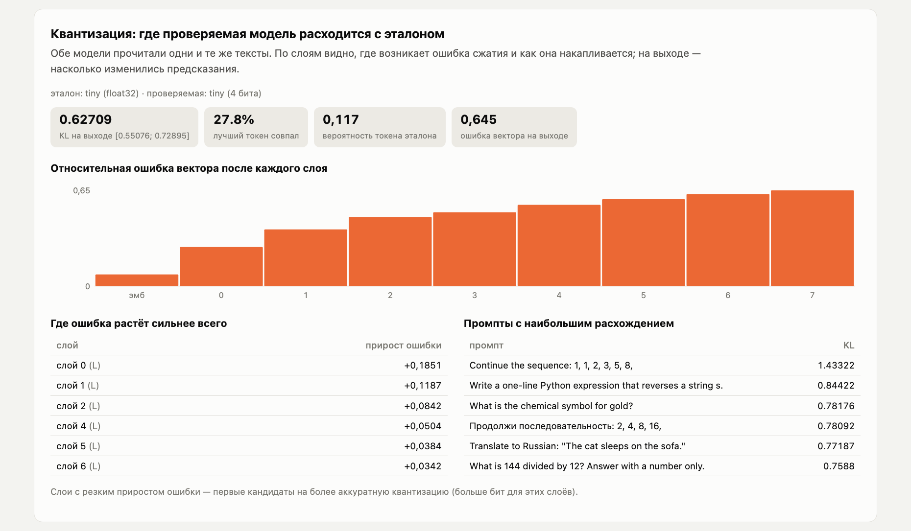

**Что показывает.** Две версии одной модели читают одни и те же тексты. По слоям — косинус и относительная ошибка векторов (где возникает ошибка сжатия и как накапливается), на выходе — KL с доверительным интервалом, доля совпавших лучших токенов и промпты с наибольшим расхождением. Слои с резким приростом ошибки — кандидаты на большее число бит.

**Важно.** Этот снимок сделан на крошечной случайной модели (float32 против 4 бит): числа ничего не говорят о Qwen и нужны, чтобы показать раздел. На настоящей паре моделей команда пока проверена только на паре «модель против самой себя» (KL 0, как и должно быть).

</details>

<details>
<summary><b>14. Пакет промптов</b> — один отчёт на много вопросов</summary>

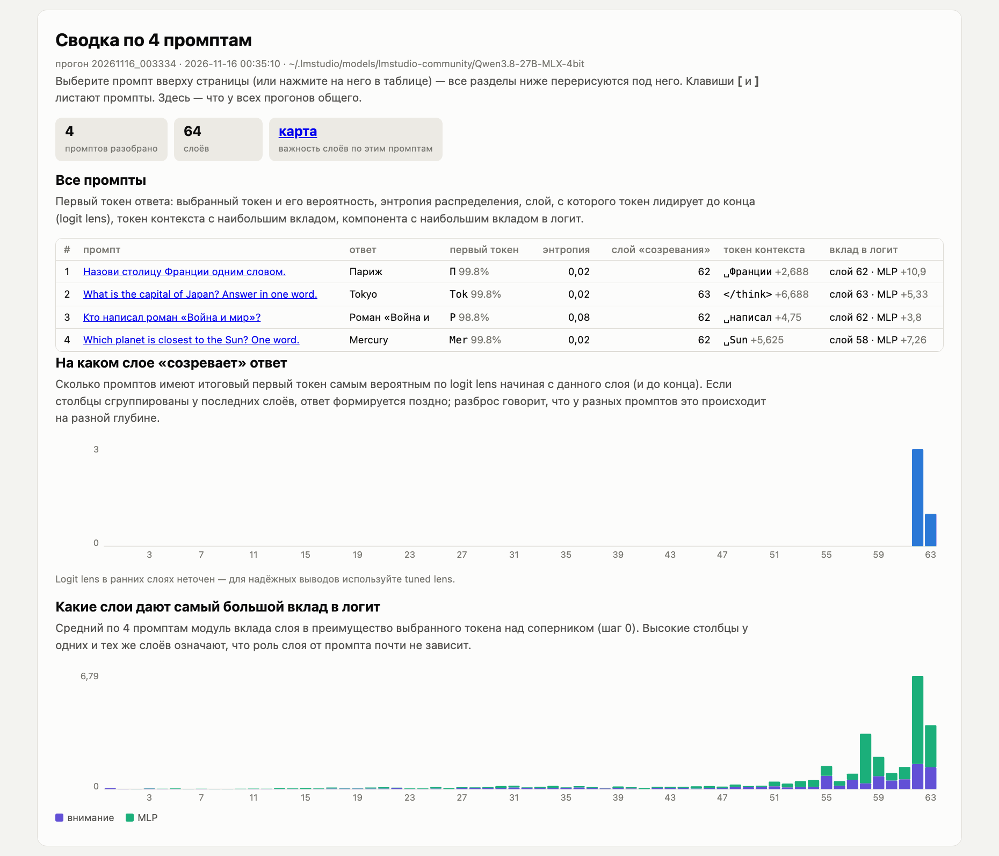

**Что показывает.** С `--batch` каждый промпт разбирается так же подробно, а в одном `report.html` вверху появляется переключатель: «Сводка» и каждый промпт отдельно (кнопки ‹ ›, список или клавиши `[` и `]`). Все разделы перерисовываются под выбранный промпт, позиция прокрутки сохраняется. В тепловой карте слоёв промпты — ссылки на их разбор.

**Пример.** В сводке по четырём промптам итоговый токен у всех становится самым вероятным на слоях 62–63; больше всего в логит дают MLP последних слоёв (слой 62, слой 58). Токен контекста с наибольшим вкладом: `␣Франции`, `</think>`, `␣написал`, `␣Sun` — для японского вопроса это служебный `</think>` (+6,7): замена этого токена нарушает структуру ответа, так что вклад служебных токенов нужно читать как зависимость от формата, а не от смысла.

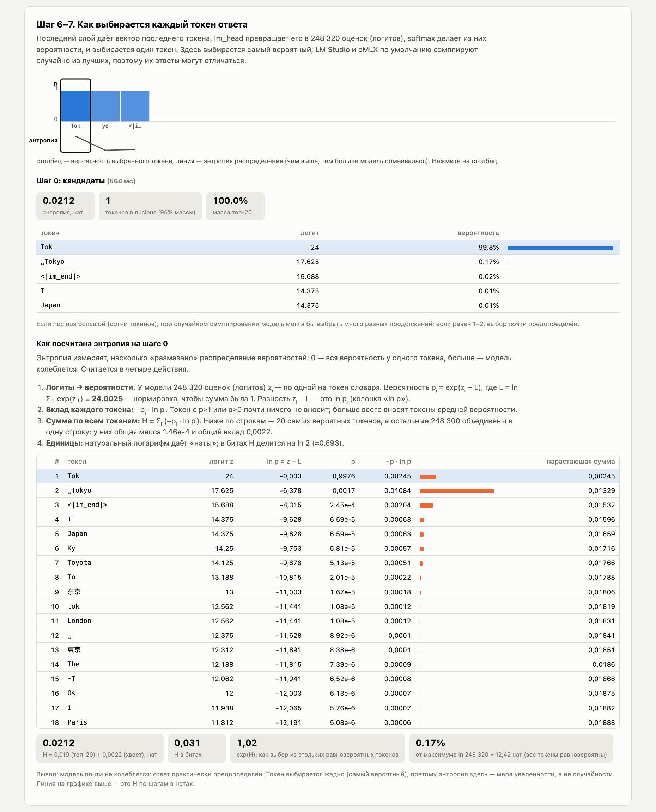

Так выглядит тот же раздел после переключения на второй промпт («столица Японии»: `Tok` — 99,8%, энтропия 0,0212).

</details>

<details>
<summary><b>15. Веса</b> — из чего состоит модель</summary>

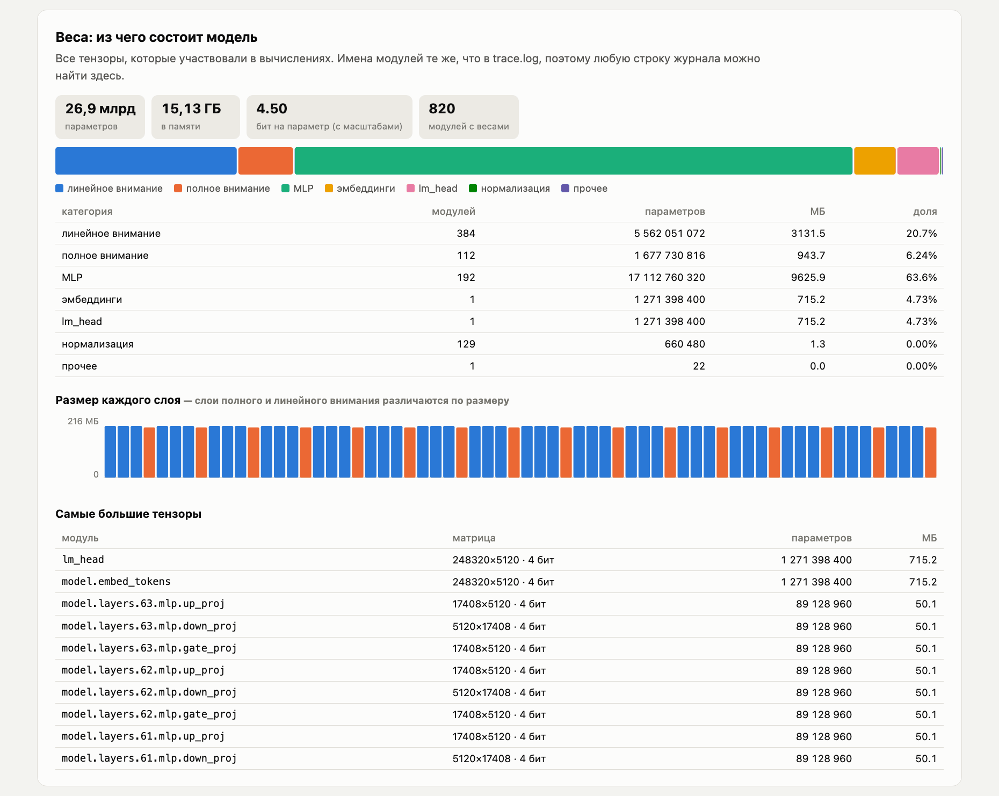

**Что показывает.** Все тензоры, которые участвовали в вычислениях; имена модулей те же, что в `trace.log`, так что любую строку журнала можно найти здесь.

**Пример.** 26,9 млрд параметров, 15,13 ГБ, 4,50 бита на параметр с учётом масштабов квантизации. MLP — 63,6% параметров, линейное внимание — 20,7%, полное — 6,2%, эмбеддинги и `lm_head` — по 4,7% (по 715 МБ). Слои полного и линейного внимания почти одного размера (≈216 МБ), хотя устроены по-разному.

</details>

## Быстрый старт

Нужны macOS на Apple Silicon, Python 3.10+, `mlx` и `mlx-vlm`. Из корня проекта (в `.venv` всё есть):

```bash
.venv/bin/python -m layerscope trace /путь/к/модели "Назови столицу Франции одним словом."
```

Если поставить пакет (`pip install -e ".[dev]"`), то же — командой `layerscope trace ...`. В `trace_logs/<дата_время>/` появятся `trace.log` (читаемый журнал), `events.jsonl` (те же события в JSON) и `report.html`.

Список команд: `python -m layerscope --help`; справка по команде: `python -m layerscope <команда> --help`. Если первый аргумент — не команда, выполняется `trace`.

## Технологии

| | Что и зачем |
|---|---|
|  | Весь проект — пакет на Python без тяжёлых зависимостей, кроме MLX |
|  | [MLX](https://github.com/ml-explore/mlx) — массивный фреймворк Apple для Apple Silicon: ленивые вычисления, быстрая 4-битная квантизация |
|  | [mlx-vlm](https://pypi.org/project/mlx-vlm/) — загрузка и запуск Qwen3.5/3.8 (`qwen3_5`); layerscope перехватывает вызовы его модулей |
|  | Семейство моделей, под которое написан инструмент; гибрид Gated DeltaNet ([NVlabs/GatedDeltaNet](https://github.com/NVlabs/GatedDeltaNet)) и полного внимания |
|  | Источник проверяемой модели ([lmstudio-community](https://huggingface.co/lmstudio-community)) и приложение, с которым результаты полезно сравнивать |
|  | Хранение весов и карточка [модели](https://huggingface.co/lmstudio-community/Qwen3.8-27B-MLX-4bit) |
|  | Необязательно: тесты выполняют скрипт страницы отчёта с заглушкой DOM |
|  | Необязательно: `docs/make_screenshots.py` снимает разделы отчёта для этого README |

## Команды

| Команда | Вопрос, на который отвечает | Цена |
|---|---|---|
| `trace` | Что вычислялось на каждом шаге, когда «созрел» ответ, какие слои и токены к нему привели | один прогон; с `--batch` — по прогону на промпт |
| `layer-map` | Какие слои важны, какие можно убрать | минуты (с `--fast` — секунды, только угловое расстояние) |
| `patch` | Где именно проходит информация, отличающая два промпта | слои × позиции прогонов |
| `tuned-lens` | Что модель «думает» в ранних слоях (точнее, чем logit lens) | обучение один раз, минуты |
| `quant-compare` | Где квантизация искажает модель | два прогона по набору промптов |
| `report` | Пересобрать `report.html` из готовых журналов (модель не нужна) | мгновенно |

### trace — один прогон подробно

```bash
python -m layerscope trace МОДЕЛЬ "промпт" --max-tokens 30
python -m layerscope trace МОДЕЛЬ "промпт" --skip-layers 3,35,40-43        # отключить слои и сравнить
python -m layerscope trace МОДЕЛЬ "промпт" --temperature 0.7 --top-p 0.9 --seed 1
python -m layerscope trace МОДЕЛЬ "промпт" --tuned-lens tuned_lens.safetensors
python -m layerscope trace МОДЕЛЬ "промпт" --layer-map                     # + карта важности
```

По умолчанию подробно разбираются **все токены ответа** и токен конца, но не больше `--max-tokens` (20); шаги переключаются в отчёте, а если ответ оборван по `--max-tokens`, отчёт об этом пишет. `--detail-steps N` ограничивает разбор первыми N шагами — для экономии времени. По умолчанию токен выбирается жадно; с `--temperature` > 0 включается сэмплирование, `--seed` делает его повторяемым. Первое событие в `events.jsonl` — `meta`: версии библиотек, отпечаток модели, параметры запуска.

### Пакетный режим

```bash
python -m layerscope trace МОДЕЛЬ --batch prompts/extended.txt --max-prompts 10 --layer-map
python -m layerscope trace МОДЕЛЬ --batch                      # 24 встроенных промпта
python -m layerscope trace МОДЕЛЬ "мой промпт" --batch ФАЙЛ    # мой промпт — первым
python -m layerscope report trace_logs/<папка_пакета>          # пересобрать отчёт без модели
```

**Какие промпты берутся.** Файл читается построчно (пустые строки и строки с `#` пропускаются), порядок сохраняется, а `--max-prompts N` берёт **первые N** — случайности и разнообразия нет. В `prompts/extended.txt` промпты идут блоками по темам, поэтому первые 10 — все из блока «факты»; для разнообразной выборки составьте свой файл.

В папке пакета: подпапка `NN_<промпт>/` на каждый промпт (его `trace.log` и `events.jsonl`; `python -m layerscope report trace_logs/<пакет>/NN_...` соберёт для неё отдельный отчёт), общий `layer_map.json` и `batch.json`. Сбой на одном промпте пакет не прерывает. Размер отчёта растёт линейно (порядка 1 МБ на промпт на 27B), поэтому для больших пакетов берите `--max-prompts`.

### layer-map — важность слоёв

```bash
python -m layerscope layer-map МОДЕЛЬ                                   # 24 встроенных промпта
python -m layerscope layer-map МОДЕЛЬ --prompts prompts/extended.txt    # 120 промптов, надёжнее
python -m layerscope layer-map МОДЕЛЬ --fast                            # без перебора
python -m layerscope layer-map МОДЕЛЬ --window 4                        # отключать блоками по 4
python -m layerscope layer-map МОДЕЛЬ --run-dir trace_logs/<папка>      # добавить в готовый отчёт
```

Два измерения: **отключение слоёв** (KL, доля сломанных токенов, Δlog p, доверительный интервал; список «кандидатов на удаление» строится по верхней границе интервала) и **угловое расстояние** блоков. С `--thinking` сравниваются токены ответа после блока рассуждений.

### patch — где проходит информация

```bash
python -m layerscope patch МОДЕЛЬ --clean "Столица Франции —" --corrupt "Столица Италии —"
python -m layerscope patch МОДЕЛЬ --clean "..." --corrupt "..." --component all --run-dir trace_logs/<папка>
```

Промпты лучше подбирать одинаковой длины в токенах. Оценка клетки: 0 — ничего не изменилось, 1 — чистый ответ полностью вернулся.

### tuned-lens — исправленный logit lens

```bash
python -m layerscope tuned-lens МОДЕЛЬ --texts corpus.txt --out tuned_lens.safetensors
```

Для каждого слоя обучается малоранговое аффинное преобразование в базис последнего слоя ([идея](https://tuned-lens.readthedocs.io/)); сама модель не меняется. Без `--texts` линза учится на встроенных промптах и получается грубой — для аккуратной нужен текст хотя бы на несколько сотен тысяч токенов. После обучения печатается KL на отложенных текстах для обычного logit lens и для линзы. На Qwen3.8-27B эта команда пока не запускалась.

### quant-compare — цена квантизации

```bash
python -m layerscope quant-compare /путь/к/исходной /путь/к/4-битной --run-dir trace_logs/<папка>
```

Модели загружаются по очереди (память нужна на одну). Раздел «Квантизация» в отчёте появляется только при `--run-dir` обычного прогона; в отчёте пакета его пока нет.

## Чему можно верить

Подробно — в [docs/validation.md](docs/validation.md): что сверено с настоящей моделью, что остаётся приближением и что убрано после проверки.

- **Проверено на 27B:** разложение логита (25,486 против настоящего 25,5), веса внимания (ошибка около 1% из-за bf16), вклад токенов прямой подменой, работа всех команд.
- **Приближения:** logit lens в ранних слоях, подмена токена средним эмбеддингом, важность слоёв по отключению (верна только для своих промптов; слой 0 несопоставим с остальными).
- **Убрано после проверки:** градиентный вклад токенов (не сошёлся с подменой) и градиентная оценка важности слоёв (корреляция с перебором 0,12); код лежит в `layerscope/experimental.py`.
- **Не проверялось:** tuned lens и сравнение квантизаций на настоящей паре моделей, вид страниц в разных браузерах, совпадение шаблона чата с LM Studio.
- **Не реализовано:** разреженные автоэнкодеры (для Qwen3.5-27B есть готовые, см. [docs/related-tools.md](docs/related-tools.md)) и дообучение модели после удаления слоёв.

## Устройство проекта

```
layerscope/            пакет
  __main__.py          точка входа и список команд
  core.py              Hooks (перехват модулей), числовые утилиты, загрузка модели, метаданные
  journal.py           Journal: trace.log и events.jsonl
  tracer.py            Tracer: журнал вызовов модулей, веса внимания
  analysis.py          анализ шага: энтропия, logit lens, разложение логита, вклад токенов
  pipeline.py          один прогон: generate и run
  batch.py             пакетный режим
  cli.py               команда trace
  attribution.py       разложение логита, подмена токена, угловое расстояние
  experimental.py      градиентные методы (в отчёты не входят)
  layer_map.py  patching.py  tuned_lens.py  quant_compare.py    остальные команды
  report/
    template.html      вся страница отчёта: HTML, CSS, JS
    data.py            чтение журналов, сводка прогона
    build.py           вставка данных в шаблон; один прогон или пакет
prompts/               наборы промптов
tests/                 тесты на крошечной модели, check_report.js
examples/              готовые отчёты и скрипт, собирающий пример на крошечной модели
docs/                  проверка, готовые инструменты, снимки для README, справочник
```

Главное: `core.Hooks` — контекстный менеджер, который перехватывает вызовы модулей и умеет отключать слои, подменять и запоминать выходы; на выходе из `with` модель возвращается в исходное состояние. Отчёт строится из журналов и не импортирует MLX, поэтому пересобирается без модели.

## Примеры и тесты

Открывайте двойным щелчком:

- [examples/qwen38_27b_single.html](examples/qwen38_27b_single.html) — один промпт на Qwen3.8-27B с картой слоёв и патчингом;
- [examples/qwen38_27b_batch.html](examples/qwen38_27b_batch.html) — четыре промпта в одном отчёте с переключателем;
- [examples/tiny_model.html](examples/tiny_model.html) — все разделы, включая tuned lens и сравнение квантизаций, на крошечной случайной модели (числа ничего не значат); пересобирается `python examples/make_tiny_example.py`.

Снимки для этого README делает `python docs/make_screenshots.py` (нужен Google Chrome; в отчёте есть режим снимка `#shot=<раздел>`).

```bash
.venv/bin/python tests/run_all.py          # без pytest; можно передать часть имени: ... run_all.py attention
pytest                                     # если pytest установлен
```

Тесты идут на крошечной случайной модели той же архитектуры (`tests/tiny.py`), веса скачивать не нужно. Проверяется в том числе математика: сумма вкладов равна настоящему логиту, восстановленные веса внимания дают выход настоящего внимания, пакетная подмена токенов совпадает с подменой по одному, патчинг последнего слоя полностью восстанавливает ответ. Если установлен `node`, выполняется ещё и скрипт страницы отчёта (`tests/check_report.js`: сводка, каждый промпт, кнопки переключения); им можно проверить любой готовый отчёт: `node tests/check_report.js путь/к/report.html`.
